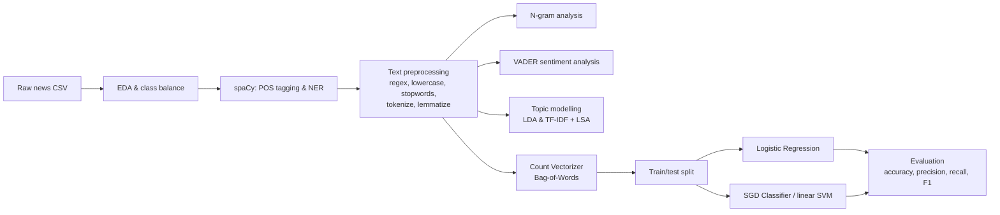

# 📰 Fake News Classification using NLP & Machine Learning

An end-to-end NLP project that explores how fake news differs from factual news and builds a text classifier to tell them apart. It was framed as a task for a social media company that wants to detect misleading content on its platform.

   

---

## 🎯 Objective
Investigate the linguistic signals that separate fake from factual news, then use them to build a classifier that labels an article as **Fake News** or **Factual News**.

## 📦 Dataset
- A labelled CSV with `title`, `text`, `date` and `fake_or_factual` columns.
- Small and nearly balanced between the two classes.

## 🏗️ Project Architecture



## 🔄 Workflow
1. **Data loading & EDA**: inspected the structure, checked for nulls and checked class balance.
2. **Linguistic exploration**: used spaCy to get part-of-speech and named-entity tags, then compared the most frequent nouns, verbs, adjectives and entities in fake versus factual articles.
3. **Text preprocessing**: removed location datelines with regex, lowercased, stripped punctuation and stopwords, tokenized and lemmatized.
4. **N-gram analysis**: looked at the most common unigrams and bigrams after cleaning.
5. **Sentiment analysis**: scored each article with VADER and compared sentiment across the two classes.
6. **Topic modelling**: ran LDA and TF-IDF + LSA on the fake news corpus, choosing the number of topics by coherence score.
7. **Classification**: vectorized the text with Bag-of-Words, trained Logistic Regression and an SGD (linear SVM) classifier, and evaluated both with accuracy and a precision/recall/F1 report.

## 🔍 Key Insights
- **Vocabulary differs by style.** Factual articles lean on reporting language ("said", "reported", "declined", "according") and institutional nouns (government, administration, bill, tax). Fake articles use more informal, opinion-driven wording.
- **Formatting leaves a trace.** Many factual articles open with a location dateline, and fake articles carry web-style artifacts such as "Featured" and "image via". The dateline needed to be removed so the model could not learn from it.
- **Topics concentrate on politics.** Topic modelling of the fake corpus centres on US political figures and issues (Trump, Clinton, Republicans, women, schools), which shows that fake content clusters around polarising subjects.
- **Simple models work well.** Linear classifiers on a Bag-of-Words representation separated the two classes well, so word choice alone is a strong signal.

## ✅ Conclusion
Fake and factual news can be separated using writing style and vocabulary alone. A lightweight pipeline of cleaning, vectorization and a linear model gives a solid, interpretable baseline. Logistic Regression performed slightly better than the SGD classifier. The next step would be a larger dataset, TF-IDF features, cross-validation, hyperparameter tuning and a transformer model such as BERT.

## 🧰 Skills, Techniques & Tools

| Category | What I used | Where in the project |
|---|---|---|
| **Languages & environment** | Python, Jupyter Notebook | Whole project |
| **Data handling** | pandas, NumPy-style array operations, `groupby`, `pd.concat`, `apply` | EDA, tagging, preprocessing |
| **Data visualization** | Matplotlib, Seaborn (custom palettes, bar and count plots) | EDA, entities, n-grams, sentiment |
| **NLP preprocessing** | Regex, lowercasing, stopword removal, tokenization, lemmatization (NLTK) | Text preprocessing |
| **Linguistic analysis** | POS tagging, Named Entity Recognition (spaCy) | Exploratory analysis |
| **Feature engineering** | n-grams, Bag-of-Words (CountVectorizer), TF-IDF | N-grams, topic modelling, classifier |
| **Sentiment analysis** | VADER compound score, binned into positive, neutral and negative | Sentiment analysis |
| **Topic modelling** | LDA, LSA/LSI (Gensim), coherence score (c_v) for choosing the topic count | Topic modelling |
| **Machine learning** | Logistic Regression, SGDClassifier (linear SVM) | Classification |
| **Model evaluation** | Train/test split, accuracy, precision, recall, F1, classification report | Classification |
| **Concepts** | Supervised vs unsupervised learning, text vectorization, class balance, dimensionality reduction, interpretability | Whole project |

## 📄 Resume-Ready Summary

**Fake News Classification | Python, NLP, scikit-learn, spaCy, NLTK, Gensim**
- Built an end-to-end NLP pipeline that classifies news articles as fake or factual, covering exploration, cleaning, feature extraction and modelling.
- Used spaCy POS tagging and NER to find linguistic differences between the two classes, and applied regex, stopword removal and lemmatization to prepare the text.
- Ran sentiment analysis with VADER, and topic modelling with LDA and TF-IDF + LSA with coherence-based tuning, to find the themes and tone of misleading content.
- Trained and compared Logistic Regression and SGD (linear SVM) classifiers on Bag-of-Words features, evaluated with precision, recall and F1.
- Visualized findings with Matplotlib and Seaborn and summarized actionable insights for a content-moderation use case.

## ▶️ How to Run
```bash
pip install pandas matplotlib seaborn spacy nltk gensim vaderSentiment scikit-learn
python -m spacy download en_core_web_sm
python -c "import nltk; [nltk.download(p) for p in ['punkt','stopwords','wordnet']]"
jupyter notebook fake_News_Classify.ipynb
```
Place `fake_news_data.csv` in the same folder as the notebook.

## 👤 Author
**Asish Mohanty**: aspiring Data Scientist
